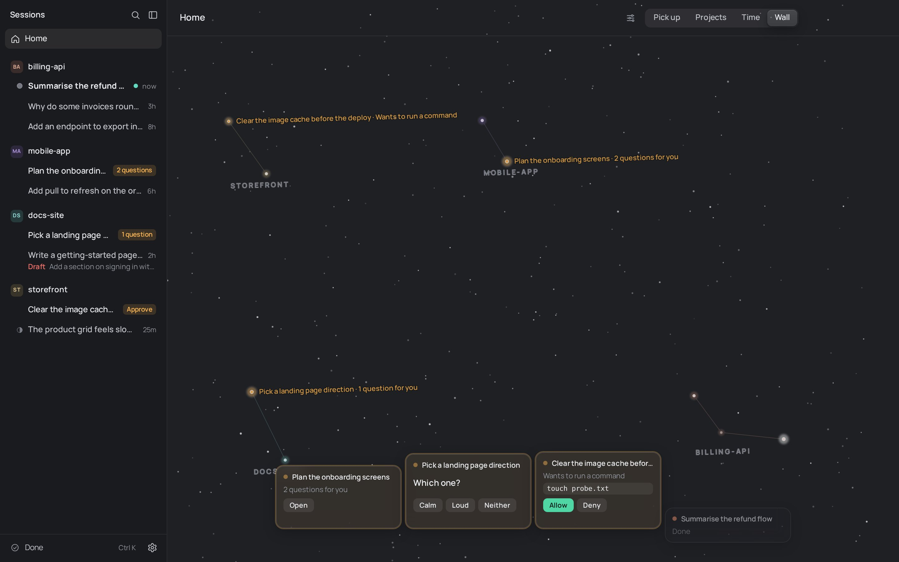
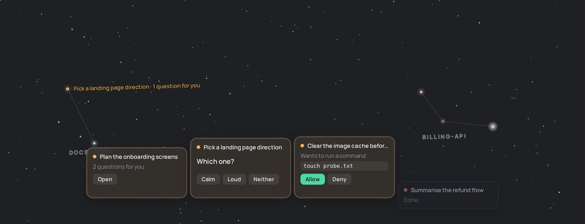
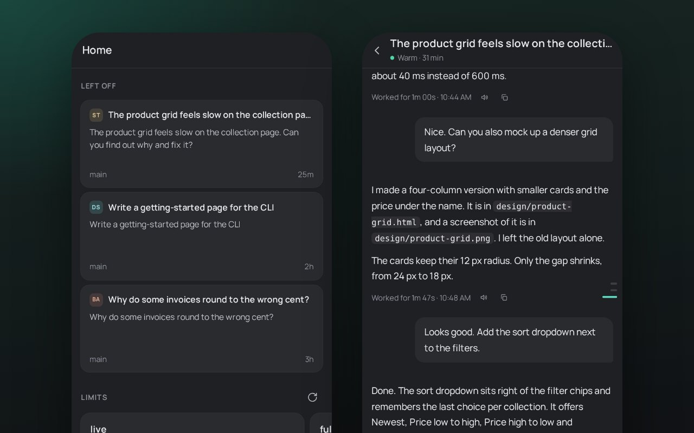
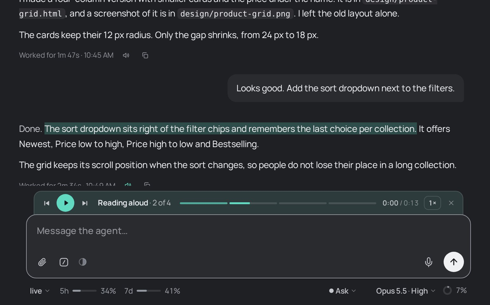
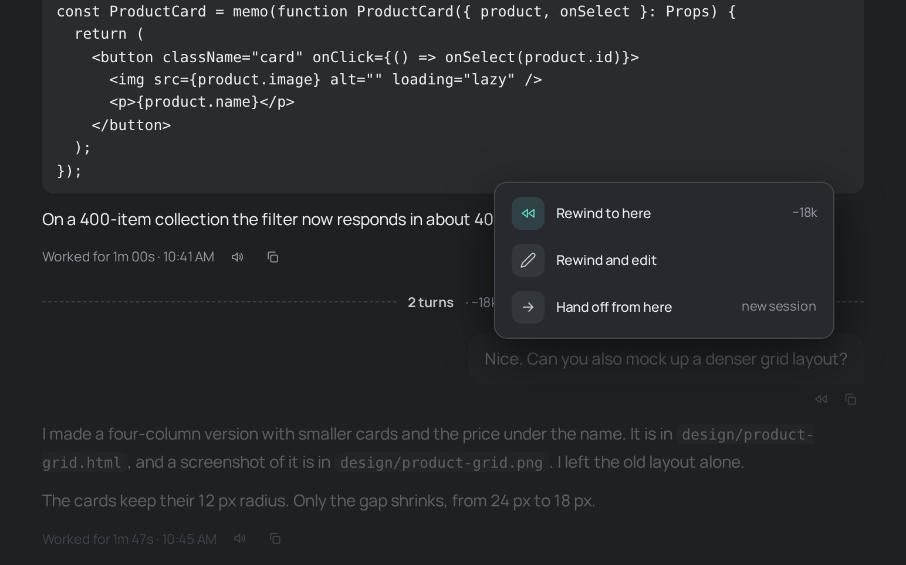
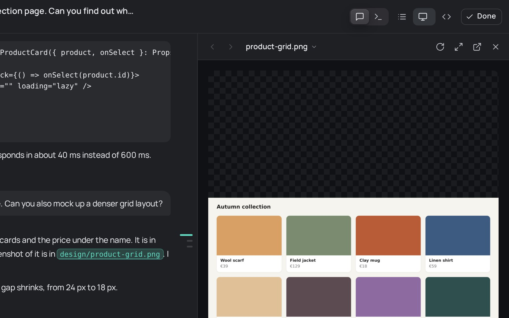
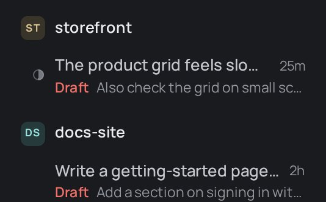

# Workwood

Run many Claude Code sessions at once. Workwood shows which are working and which are waiting for you:
an inbox of the work that still needs something, across your Claude accounts.

<picture><source media="(prefers-color-scheme: light)" srcset="site/shots/wall-full-light.jpg"></picture>

## Features

<table>
<tr>
<td width="33%" valign="top"><picture><source media="(prefers-color-scheme: light)" srcset="site/shots/wall-light.jpg"></picture><br><b>The Wall</b><br>Answer permissions and short questions from a dock.</td>
<td width="33%" valign="top"><picture><source media="(prefers-color-scheme: light)" srcset="site/shots/phones-light.jpg"></picture><br><b>On your phone</b><br>Over your home Wi-Fi, no outside server.</td>
<td width="33%" valign="top"><picture><source media="(prefers-color-scheme: light)" srcset="site/shots/read-light.jpg"></picture><br><b>Read aloud</b><br>Answers read to you, on your computer.</td>
</tr>
<tr>
<td width="33%" valign="top"><picture><source media="(prefers-color-scheme: light)" srcset="site/shots/rewind-light.jpg"></picture><br><b>Rewind</b><br>Take back a message and all after it.</td>
<td width="33%" valign="top"><picture><source media="(prefers-color-scheme: light)" srcset="site/shots/previews-light.jpg"></picture><br><b>Previews</b><br>What the agent made, beside the chat.</td>
<td width="33%" valign="top"><picture><source media="(prefers-color-scheme: light)" srcset="site/shots/drafts-light.jpg"></picture><br><b>Drafts</b><br>Unsent text stays in its session.</td>
</tr>
</table>

… and more: limits across accounts, handoffs, dictation, the real terminal. [The full guide →](docs/guide.md)

## Install it

You need Node 22 or newer, git and Claude Code. Workwood is built on your own
machine, so there is no installer to download:

```bash
git clone https://github.com/theExtraTerrestrial/workwood
cd workwood
npm ci
npm run install-app
```

- **macOS**: makes `~/Applications/Workwood.app`. Not yet tried on a Mac.
- **Linux**: adds Workwood to the app launcher. `npm ci` builds one part
  here, so it also needs `build-essential` and `python3`. Ubuntu's own `nodejs`
  package is too old; take Node 22 from nodejs.org or nvm. (`npm run shortcut`
  is for Windows with WSL only.)
- **Windows**: run it inside WSL. Workwood goes into the Start menu and
  sessions run in WSL (the same as `npm run shortcut`, described below).

On macOS and Linux the app runs straight from this folder: keep the folder where
it is. Workwood checks GitHub for updates when it starts and every three hours
(or under Settings, About), and offers a restart that pulls them, runs
`npm install` when the dependencies changed, and starts again. In the Windows
window (with WSL) the restart also makes the Windows copy again, and when this
folder changes some other way (a `git pull` by hand, a merge) the window offers
the same restart, so its copy never stays behind. It will not
update over uncommitted changes in this folder, except a `package-lock.json`
that only npm rewrote. The Windows window from before
this feature has no restart: run `npm run install-app` once more after pulling. `npm run install-app -- --remove`
takes the app away again; your sessions and settings stay.

## Run it

```bash
cd ~/workspace/workwood
npm start         # the Workwood window, without installing anything
npm run edge      # alternative: the same app in a Microsoft Edge app window
```

On Windows, run `npm run shortcut` once (inside WSL). It puts Workwood in the
Start menu as a native Windows window, installed under `%LOCALAPPDATA%\Workwood`
(Electron for Windows, downloaded once, and a Windows copy of the service).
The small word after the "Sessions" title (for example "· WSL") says where sessions run; click it to change:

- **Windows**: the service runs inside the window itself and uses the Windows
  Claude Code (`claude.exe`), your Windows folders and Claude Code's Windows
  history. Nothing goes through WSL. There is one account there: the one
  Claude Code is signed in to.
- **WSL**: the window starts the service in WSL and stops it again when the
  window closes; this is the full set-up, with all your profiles. Its output
  goes to `~/.cache/workwood/workwood.log`.

Agents on the side you are not looking at keep working. A dot next to that
word shows when one there is working (green) or waiting for you (amber).

Each side has its own settings. Under Settings, General, "Project folders"
lists the folders that hold your projects (for example `F:\workspace` on
Windows); the new-session menu offers what is inside them, and new folders are
made in the first one. Left empty, it is `~/workspace`.

The Windows side is a copy; when this folder changes, the window offers a
restart that makes it again. `npm run shortcut -- --remove` takes it all away. `npm start` still opens the
Linux window through WSLg.

When started from a terminal: keep the terminal open while you use the app; closing it or pressing Ctrl+C quits.
The terminal prints a few "Failed to connect to the bus" lines at start-up under
WSL; they are harmless.

On a fresh WSL install the Electron window needs GTK once:
`sudo apt install libgtk-3-0`.

## Tests

```bash
npm test
```

About 100 seconds, 112 tests. They run the real service inside a throwaway
home folder (the same idea as Claudius's own tests), with a scripted stand-in
for `claude` (`tests/fake-claude.mjs`) and local stand-ins for Claude's usage
and sign-in servers. Claudius is not used. No real account is
used and nothing is sent to Anthropic. Half of the tests drive the window with
real clicks in a headless Chromium; they are skipped with a note if none is
found (`npx playwright install chromium-headless-shell`, or set `WORKWOOD_CHROME`).
The last test checks that nothing leaked out of the sandbox.

## How it is put together

- `service/` is a small local web server (Node). It reads profiles
  (`profiles.mjs`), limits (`usage.mjs`) and sessions itself, renews sign-ins
  under the shared lock (`oauth.mjs`), asks `claude agents --json` what is
  running, and runs turns with the Claude
  Agent SDK. It listens on this machine only, and every request needs the random
  token made at start-up. With the phone turned on it also listens on one more port
  (`phone.mjs`): plain HTTP gives only the setup page and the certificate, HTTPS
  is the app for paired phones. Previews reach the phone from that address with
  a sandbox header, so a page cannot read the phone's key.
- Previews are served from a second local address with its own random key, so a
  page an agent made is a different site from the app and cannot reach it. It
  can load files from the session's project folder and from next to any file the
  session wrote; `.git` folders and `.env` files are refused.
- `ui/` is the window's page: plain HTML, CSS and JavaScript, no build step.
- `shell/main.cjs` is the Electron window; `shell/edge.mjs` is the Edge launcher.
- `site/` is the website (`npm run site` builds it into `_site/`). `npm run shots` takes the pictures in
  `site/shots/`, used by the website and this README, from the app run against the tests' sandbox, so they
  show made-up projects only.
- `design/mockup.html` is the interactive mockup the app is built to. The other
  files in `design/` are the comparison pages the design was chosen from.

Permission prompts follow your own Claude Code settings. With
`"defaultMode": "auto"` you will rarely see a permission card.
